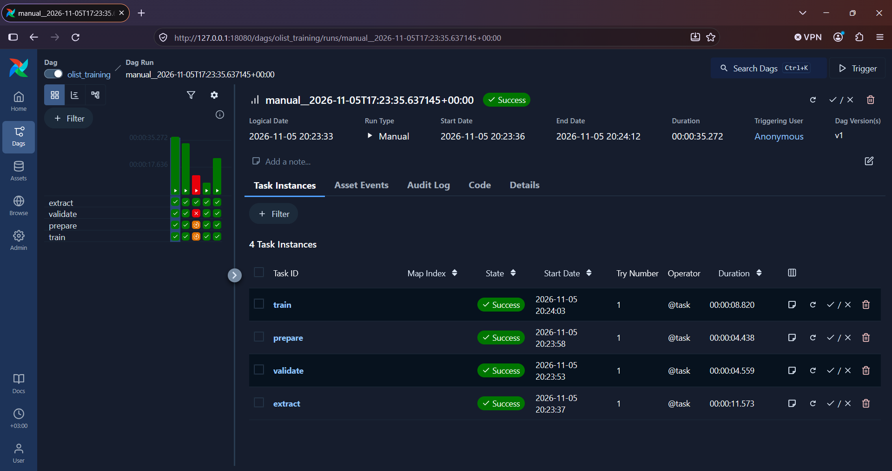
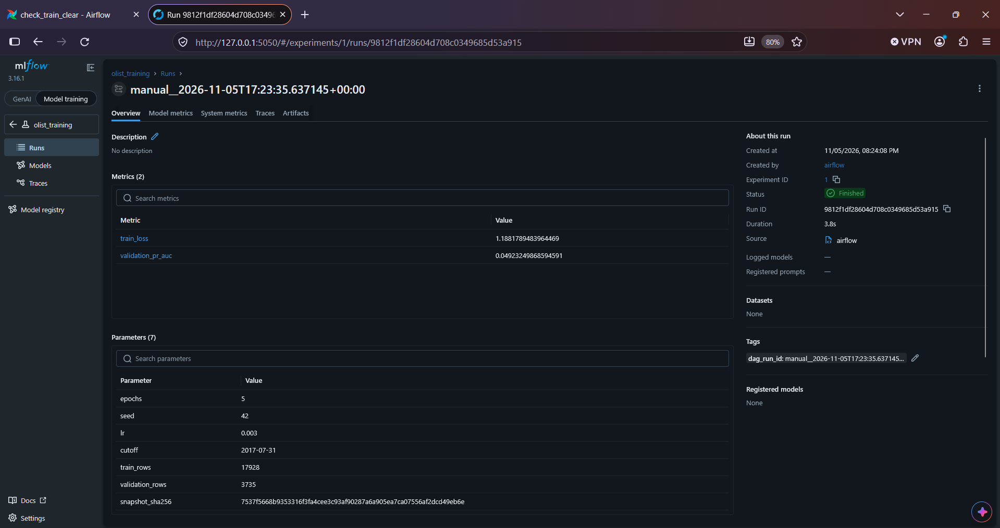

# ДЗ 2: стартовый набор

## Запустите окружение

Понадобятся Git, Docker с работающим Linux engine и Docker Compose v2. На Windows используйте Docker Desktop с WSL2 и PowerShell или терминал WSL; на macOS — Docker Desktop или совместимую VM. Python-зависимости работают внутри контейнера, обучение выполняется на CPU.

Для планирования: 8 ГБ RAM на компьютере, около 15 ГБ диска и 4 ГБ RAM с 2 CPU для Docker. Расход ресурсов зависит от платформы и сборки; минимальные требования не измерялись. Набор использует учебный Airflow standalone.

Клонируйте репозиторий и перейдите в его каталог:

```bash
git clone https://github.com/20xygen/Olist-mlflow-and-Airflow.git olist-homework
cd olist-homework
cp .env.example .env
```

Если порт 8080 занят или зарезервирован системой, измените `AIRFLOW_PORT` в `.env`, например на `18080` (у меня было так). Затем запустите сервисы. Все дальнейшие команды выполняйте из каталога `olist-homework`:

```bash
docker compose up -d --build
docker compose ps
```

Дождитесь состояния `healthy` у `source`, `mlflow` и `airflow`.

По умолчанию интерфейсы доступны по адресам [Airflow](http://127.0.0.1:8080) и [MLflow](http://127.0.0.1:5050). Я использовал другой порт для Airflow - [18080](http://127.0.0.1:18080).

## Запуск обучения

В Airflow включите DAG `olist_training` и запустите его кнопкой `Trigger`. Дождитесь состояния `Success` у всех четырех задач: `extract`, `validate`, `prepare` и `train`.

В MLflow откройте эксперимент `olist_training` и выберите созданный run. Скопируйте его идентификатор из поля `Run ID`. После запуска DAG в новом окружении замените `run_id` на идентификатор созданного у вас запуска MLflow:

```bash
docker compose exec -T airflow python -m check_model --run-id 9812f1df28604d708c0349685d53a915
```

## Проверка восстановления

В запуске `check_train_clear` задача `train` была намеренно остановлена исключением. После исправления кода был выполнен Clear только для `train`. Задача завершилась успешно со второй попытки, весь запуск получил `Success`. У `extract`, `validate` и `prepare` осталась первая попытка, время их выполнения не изменилось.

## Перезапуск и остановка

Перезапустите сервисы и пересоздайте контейнер MLflow с сохранением volume:

```bash
docker compose restart       # результаты и данные сохраняются
docker compose up -d --force-recreate --no-deps mlflow  # новый контейнер, прежний именованный volume
docker compose up -d --wait --wait-timeout 240
```

После готовности сервисов выполните прогноз по прежнему (вашему) MLflow `run_id`:

```bash
docker compose exec -T airflow python -m check_model --run-id 9812f1df28604d708c0349685d53a915
```

При проверке модель загрузилась по прежнему `run_id`, все пять прогнозов совпали с результатом до перезапуска. Параметры и метрики сохранились.

Для остановки контейнеров с сохранением volumes выполните:

```bash
docker compose down
```

## Скриншоты




